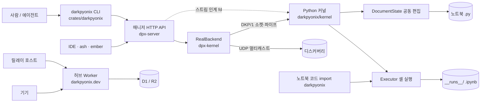

# darkpyonix 코드베이스 개요

- 분석 기준 커밋: `b68d6ab04e12c1ebb15f7bb666ea54becfd1f3cb` / 분석일: 2026-11-17
- 규모: 프로덕션 코드 82파일 / 20,276줄 (Rust 약 51%, Python 약 40%, TypeScript 약 13%) + `packaging/` 약 360줄. 테스트 72파일 / 16,721줄. 문서·OpenAPI 포함 추적 파일 약 225개 / 약 5만 줄 (`docs/설계초안/` 제외)
- 검증: 참조 338개 확인, 오류율 0% / 남은 `[추정]` 5개, `[확인 필요]` 9개 (상세 `_progress.md`)

## 한 문단 요약
DarkPyonix는 **파일 하나에 커널 하나**가 붙는 Python 노트북 실행 환경이다. 노트북은 `# %%` 마커가 들어간 평범한 `.py` 파일이고, 커널은 표준 라이브러리만으로 Python 3.8+ 어디서든 설치 없이 돈다. Rust로 된 `darkpyonix` 바이너리는 CLI이자 **버려도 되는 HTTP 앞단(매니저)** 이라서, 매니저가 죽어도 커널은 살아 있다. 커널은 실행 기록을 노트북 옆 `__runs__/`에 nbformat으로 남기고, 공동 편집 문서·접근 토큰·긴 스트림 응답까지 직접 쥔다. `darkpyonix.dev` 허브(Cloudflare Worker + Rust 릴레이)는 기기 연결, 주소 디렉터리, 공유 링크, 노트북 게시를 맡는다. 사용자는 사람(CLI), 에이전트(CLI/HTTP), IDE·ash·ember(HTTP)다.

## 기술 스택
| 영역 | 사용 기술 |
|---|---|
| 커널 + 노트북 런타임 API | Python 3.8+ 표준 라이브러리만 (`darkpyonix/kernel/`, import 이름 `darkpyonix`) |
| 매니저 + CLI | Rust 2021 워크스페이스: `dpx-core`, `dpx-kernel`, `dpx-server`, `darkpyonix` (tokio, axum, clap, rustls, SQLite) |
| 허브 API | TypeScript, Cloudflare Workers, D1, R2 (`darkpyonix/hub/worker/`) |
| 허브 릴레이 | Rust, iroh-relay (`darkpyonix/hub/server/`) |
| 프로세스 간 통신 | DKP/1: 길이 접두 JSON 프레임, Unix 소켓 / Windows named pipe, UDP 루프백 멀티캐스트 디스커버리 (`docs/PROTOCOL.md`) |
| 패키징 | hatchling (`packaging/hatch_build.py`) — 플랫폼 wheel에 Rust 바이너리 동봉 |

## 실행 방법
| 목적 | 명령 |
|---|---|
| 노트북 실행 | `darkpyonix run file.py` (매니저가 없으면 자동으로 임시 매니저 기동) |
| 커널만 직접 | `python -m darkpyonix --file file.py` |
| 매니저 | `darkpyonix manager [--ephemeral]` |
| Python 테스트 | `pytest` (저장소 루트) |
| Rust 빌드·테스트 | `cargo test` (`darkpyonix/manager/`) — **builder 서브에이전트에서만, `CARGO_BUILD_JOBS=2`** (AGENTS.md) |
| 허브 | `npm test`, `npm run typecheck`, `npm run dev` (`darkpyonix/hub/worker/`) |
| 버전 확인 | `python packaging/check_versions.py` |

## 전체 구조

## 모듈 안내
| 모듈 | 책임 | 규모 | 문서 |
|---|---|---|---|
| `kernel-infra` | 와이어 상수·프레임, 홈 경로, 잠금, 계정 확인, 이벤트 링, 모델 | 9파일 / 1,286줄 | [modules/kernel-infra.md](modules/kernel-infra.md) |
| `kernel-runtime-api` | `import darkpyonix` API, 노트북 포맷 파서 | 11 / 1,188 | [modules/kernel-runtime-api.md](modules/kernel-runtime-api.md) |
| `kernel-exec` | 셀 실행, 출력 캡처, 실행 기록 | 4 / 2,095 | [modules/kernel-exec.md](modules/kernel-exec.md) |
| `kernel-collab` | 공동 편집 문서, 토큰, 인계 스트림, WebSocket | 4 / 2,005 | [modules/kernel-collab.md](modules/kernel-collab.md) |
| `kernel-process` | 커널 프로세스, 제어 서버, 디스커버리, 런처 | 5 / 1,539 | [modules/kernel-process.md](modules/kernel-process.md) |
| `manager-core` | `KernelBackend` 계약 + 실구현 (디스커버리·기동·DKP) | 9 / 2,770 | [modules/manager-core.md](modules/manager-core.md) |
| `manager-server` | 매니저 HTTP API, 인증, 인계, 프록시, TLS | 10 / 4,505 | [modules/manager-server.md](modules/manager-server.md) |
| `cli` | `darkpyonix` 명령, 매니저 찾기·기동, 터미널 출력 | 8 / 1,823 | [modules/cli.md](modules/cli.md) |
| `hub-worker` | darkpyonix.dev API | 17 / 2,541 | [modules/hub-worker.md](modules/hub-worker.md) |
| `hub-relay` | iroh 릴레이 호스트 | 5 / 524 | [modules/hub-relay.md](modules/hub-relay.md) |
| `packaging` | wheel 빌드, 버전·스모크 검사 | 4 / 약 360 | [modules/packaging.md](modules/packaging.md) |

원자료: [_raw/](_raw/) — `inventory.tsv`, `prod.tsv`, `imports.tsv`, `fan.tsv`, `routes.md`, `entrypoints.md`, `symbols.md`(심볼 자동 추출), `modules.md`, `orphans.md`, `cycles.md`, `stack.md`.

## 상황별로 볼 문서
| 이럴 때 | 이 문서 |
|---|---|
| 사용자 피드백을 받아 고칠 곳을 찾을 때 | [01_FEATURE_MAP.md](01_FEATURE_MAP.md) → [06_FIX_GUIDE.md](06_FIX_GUIDE.md) |
| 코드에서 모르는 이름을 만났을 때 | [02_GLOSSARY.md](02_GLOSSARY.md) |
| 기능이 실제로 어떻게 동작하는지 알고 싶을 때 | [03_FLOWS.md](03_FLOWS.md) |
| 데이터 구조나 DB를 바꿀 때 | [04_DATA_MODEL.md](04_DATA_MODEL.md) |
| 코드 정리·리팩터링을 계획할 때 | [05_ISSUES.md](05_ISSUES.md) |
| 설계 이유·요구사항이 궁금할 때 | `docs/INTENT.md`, `docs/SPEC.md`, `docs/PROTOCOL.md` (프로젝트 원본 문서) |

## 가장 먼저 알아야 할 것 5가지
1. **같은 규약이 Python과 Rust에 따로 구현되어 있다.** kernel_id, 디스커버리 주소·포트, 프레임 한도, 홈 경로, 부트스트랩, 능력 이름 등. 한쪽만 바꾸면 매니저가 커널을 못 찾거나 권한이 어긋난다 → [manager-core.md 대응표](modules/manager-core.md)
2. **커널이 주인이다.** 파일 잠금, 공유 문서, 토큰, 스트림 응답은 커널이 갖고, 매니저는 인증한 뒤 넘기기만 한다. 매니저 쪽만 고쳐서 해결하려 하지 말 것
3. **SPEC과 OpenAPI가 먼저다.** 동작 변경은 `docs/SPEC.md`, 엔드포인트 변경은 `docs/api/*.openapi.yaml`부터 (AGENTS.md). OpenAPI에 없는 엔드포인트는 존재하면 안 된다
4. **커널 코드는 Python 3.8 + 표준 라이브러리만.** 서드파티 import나 3.9+ 문법을 넣으면 하드 제약 위반이다
5. **정지는 인터럽트다.** 커널 프로세스를 죽이는 곳은 `shutdown --force` 경로(`dpx-server/src/api.rs:423-432`) 하나뿐이다

## 우선 처리 권장 이슈
1. **I-001 (높음, 확인 필요)** CLI가 kernel_id를 매니저·커널과 다른 방식으로 계산 (`cli/discovery.rs:189-200`). Windows에서 `stop`/`status`/`logs`/`vars`가 "no kernel is running"을 낼 가능성 — Windows에서 재현 테스트 후 `dpx_kernel::ident::kernel_id_for`로 교체
2. **I-007 (중간)** 토큰 환경 변수 이름이 CLI(`DARKPYONIX_TOKEN`)와 매니저(`DARKPYONIX_MANAGER_TOKEN`)에서 다름
3. **I-003 (중간)** 능력 이름 5개가 4곳에 중복 정의
4. **I-017/I-019 (중간)** `dpx-server/src/api.rs` 1,979줄 단일 파일, 100줄 넘는 함수 5개
5. **I-002 (중간)** 디스커버리·프레임 상수 Python/Rust 중복

심각도 "높음"은 I-001 하나뿐이다. 보안 문제(비밀값 하드코딩, 인증 없는 API, wire eval/pickle)는 발견하지 못했다.

## 변경 이력
- 2026-11-17: 최초 분석 (커밋 `b68d6ab`)
