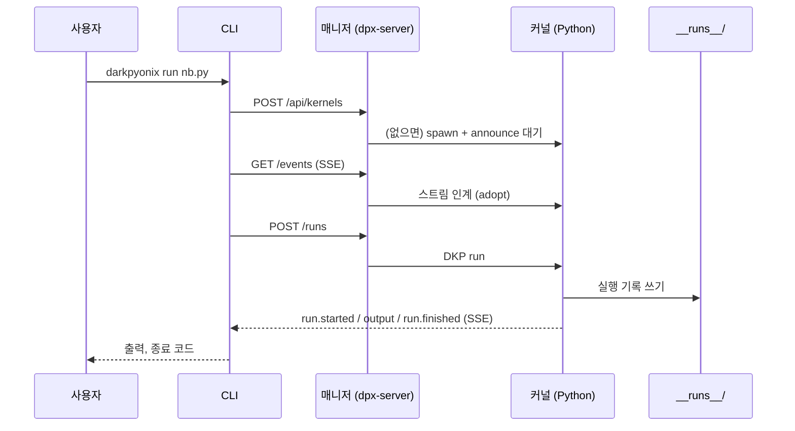
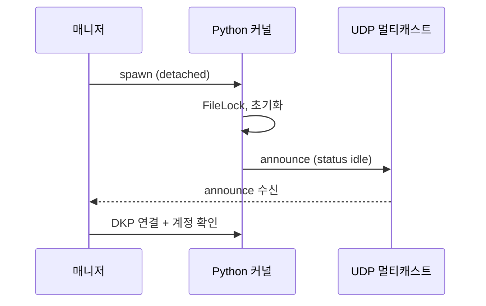
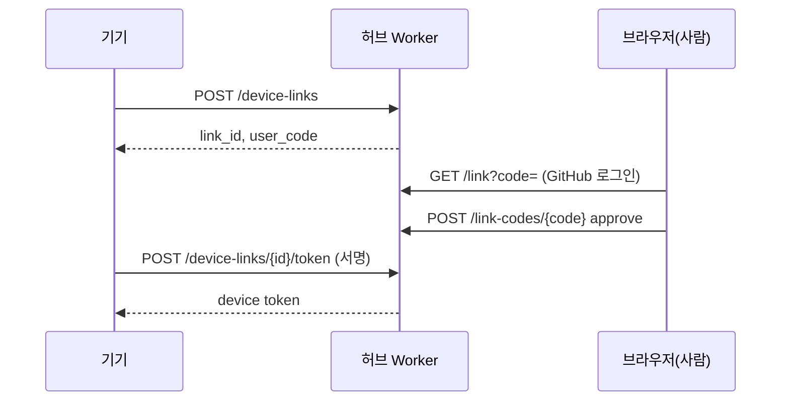

# 핵심 흐름

경로 약어: `cli/`, `srv/`, `kern/`, `hub/`, `dpx-kernel/` ([01_FEATURE_MAP.md](01_FEATURE_MAP.md) 참조).

## 흐름 1: `darkpyonix run FILE` (파일 실행하고 출력 따라가기)

1. `cli/main.rs:17` clap 파싱 → `cli/commands.rs:89` `dispatch_inner`
2. `cli/discovery.rs:189` `resolve_file` — 파일 → 정규 경로 + `kernel_id`
3. `cli/discovery.rs:50` `connect` — `DARKPYONIX_MANAGER_URL`/`DARKPYONIX_TOKEN`이 있으면 그 매니저, 없으면 `spawn_ephemeral` `:114`로 `darkpyonix manager --ephemeral`을 띄우고 stdout JSON 1줄(`ManagerLine` `:23`)에서 URL·토큰을 읽음
4. `cli/commands.rs:243` `ensure_kernel` → `POST /api/kernels {path, python?}` → `srv/api.rs:365` `start_kernel` → `RealBackend::ensure` (이미 있으면 200, 없으면 `dpx-kernel/launch.rs:135` `spawn_kernel`로 띄우고 announce 대기 후 201)
5. `cli/commands.rs:268` **실행 전에** `GET .../events` 구독 (이벤트 누락 방지)
6. `cli/commands.rs:270` Ctrl-C 핸들러 설치
7. `POST .../runs {mode, cells?, params?, on_busy}` → `srv/api.rs:728` `start_run` — `Execute` 능력 검사, 본문 검증 → `call(..., "run")` → 202
8. 커널 `kern/__main__.py:141` `_run` → `kern/_executor.py:128` `submit` → `run.queued` 이벤트, 큐에 넣음
9. 메인 스레드 `run_forever` `:377` → `run.started` (`:549`) → 셀마다 `cell.started` (`:621`), 출력은 `OutputRouter`가 `output` 이벤트로 → `cell.finished` (`:635`) → `run.finished` (`:586`); 동시에 `RunStore`가 `__runs__/<file>/<run_id>.ipynb` 기록
10. CLI `follow` `cli/commands.rs:438` → `handle_event` `:517`가 출력 표시, `run.finished`에서 `exit_code_for_run_status` (`render.rs:13`)로 종료
- 이미 바쁘면: 7에서 `busy` 오류 → `busy` `commands.rs:300` 안내 출력, exit 75

**데이터 형태:** CLI 인자 → `RunBody` JSON (`srv/api.rs:713`) → DKP `run` params(`mode`, `cells`/`cell_ids`, `params`, `on_busy`, `client`) → `RunRequest` (`kern/_model.py:14`) → `Run`/`CellRecord` → 이벤트 `{seq, type, time, data}` → SSE `id/event/data` → 터미널 텍스트

## 흐름 2: 커널 기동과 디스커버리

1. 매니저 `dpx-kernel/launch.rs:32` `extract_runtime` — 내장 Python 패키지를 `<home>/runtime/<tag>/`에 1회 추출
2. `resolve_python` `:95` — 요청값 → `DARKPYONIX_PYTHON` → PATH
3. `spawn_kernel` `:135` — `[python, "-c", BOOTSTRAP, "--file", canonical]` 분리 실행
4. 커널 `kern/__main__.py:189` `Kernel.run` — 잠금 → 문서·토큰·실행기록·실행기·제어서버 → `DiscoveryResponder.start` (초기화 순서는 `_raw/entrypoints.md`)
5. 커널이 `239.255.68.80:46880`(루프백)로 announce, 매니저 `dpx-kernel/discovery.rs:46` `Discovery`가 캐시
6. 매니저가 announce의 `control`(소켓 경로 / 파이프 이름)로 DKP 연결 → `require_same_account` (`dkp.rs:106`) / `require_same_sid` (`:157`)
- 같은 파일에 두 번째 커널: `FileLock.acquire` 실패 → 기존 커널 정보 stderr 출력, exit 3 (`__main__.py:190-196`)

## 흐름 3: 공동 편집 — 셀 수정

1. 클라이언트(ember/ash) `PATCH /api/kernels/{id}/cells/{cell_id}` + 헤더 `X-DarkPyonix-Client`, `X-DarkPyonix-Request`
2. `srv/api.rs:1512` `update_cell` — `Edit` 능력, `required_client` `:283`, `edit_params` `:1464`, `with_rid` `:1454`
3. `call(..., "doc.cell.update")` → 커널 `kern/_collab.py:499` `cell_update` (잠금·버전 검사)
4. 커널이 `doc.cell.updated` 이벤트 발행 → 이벤트 스트림/WebSocket으로 모든 참여자에게
5. 디바운스 후 파일 저장 (`tick` `:253`), 실행 직전에는 `flush` `:224`
- 외부에서 파일이 바뀌면 `_reload` `:760` → `doc.reloaded` 또는 `doc.conflict`

## 흐름 4: 긴 스트림 인계 (이벤트 SSE / WebSocket / run wait)

1. 평문 TCP: `srv/handoff.rs` `intercept`가 요청 머리를 엿봄 → `parse_head` `:45`, 토큰 `token_of` `:89` (Bearer 또는 `?token=`)
2. 매니저가 인증·인가 (`plan_handoff` `srv/api.rs:1903`)
3. 토큰을 지운 요청(`build_request` `:107`)과 소켓을 커널로: POSIX는 `SCM_RIGHTS` fd 전달(`dpx-kernel/dkp.rs:705`, `:746`), Windows는 `adopt` `:806`
4. 커널 `kern/_streams.py:138` `StreamHub.adopt` — 커널이 직접 HTTP 응답. 매니저 유휴 타이머는 이 연결을 세지 않음 (`srv/handoff.rs:25`)
5. TLS 등 인계 불가 연결은 `pump_response` `srv/handoff.rs:142`로 매니저가 중계
- 공유 폐기 시 커널이 해당 스트림을 닫음 (`kern/_tokens.py` → `close_share` `__main__.py:216`)

## 흐름 5: 허브 기기 연결 (darkpyonix.dev)

1. 기기 `POST /device-links` → `hub/devices.ts:167` `createLink` → `device_links` 행(`pending`), `user_code` 반환
2. 사람이 브라우저로 `/link?code=XXXX-XXXX` → `hub/app.ts:85` (미로그인 시 GitHub 로그인 `hub/github.ts:41`)
3. 승인 → `POST /link-codes/{code}` → `decideLinkCode` `:265` (`approved`; main server 교체는 `replace`)
4. 기기가 개인키 서명으로 `POST /device-links/{id}/token` → `claimLink` `:338` → `devices` 행 생성, 기기 토큰(해시 저장) 발급
5. 이후 기기는 `PUT /pkarr/{key}`로 주소 게시, 릴레이 접속 시 릴레이 호스트가 `POST /internal/relay/admit`로 허가 확인

